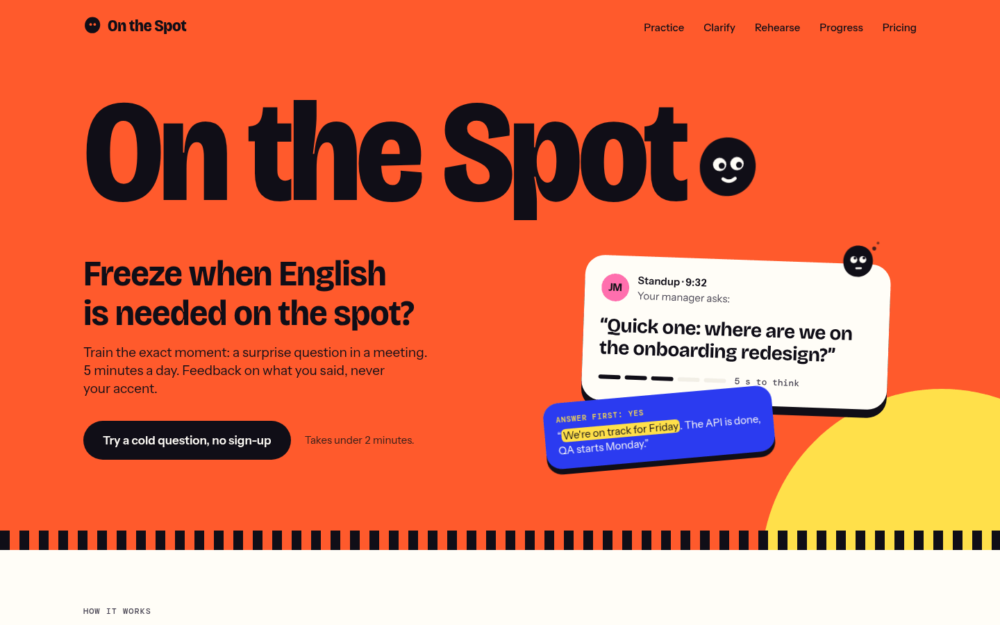
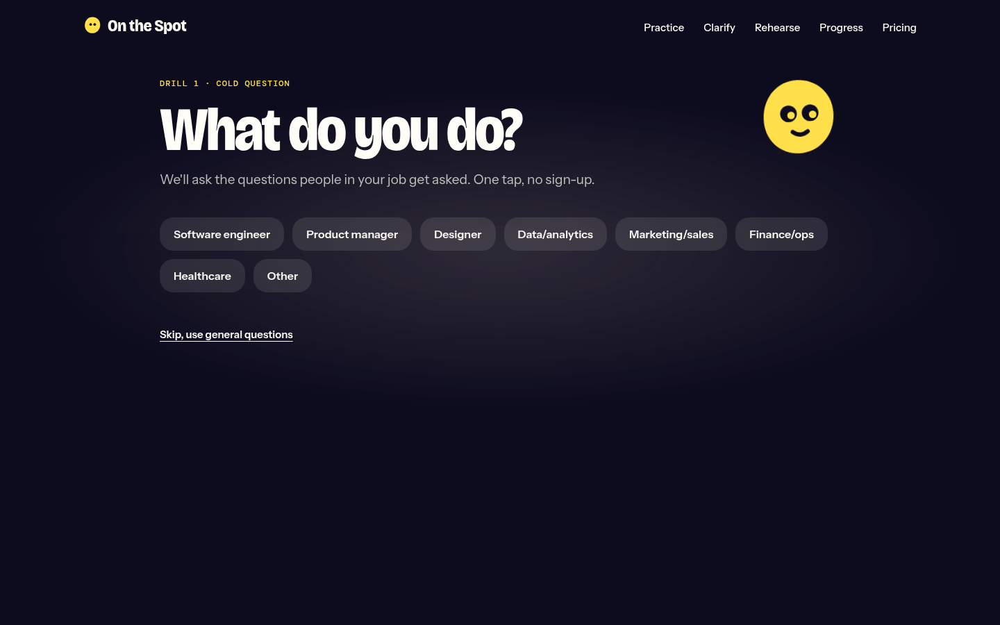
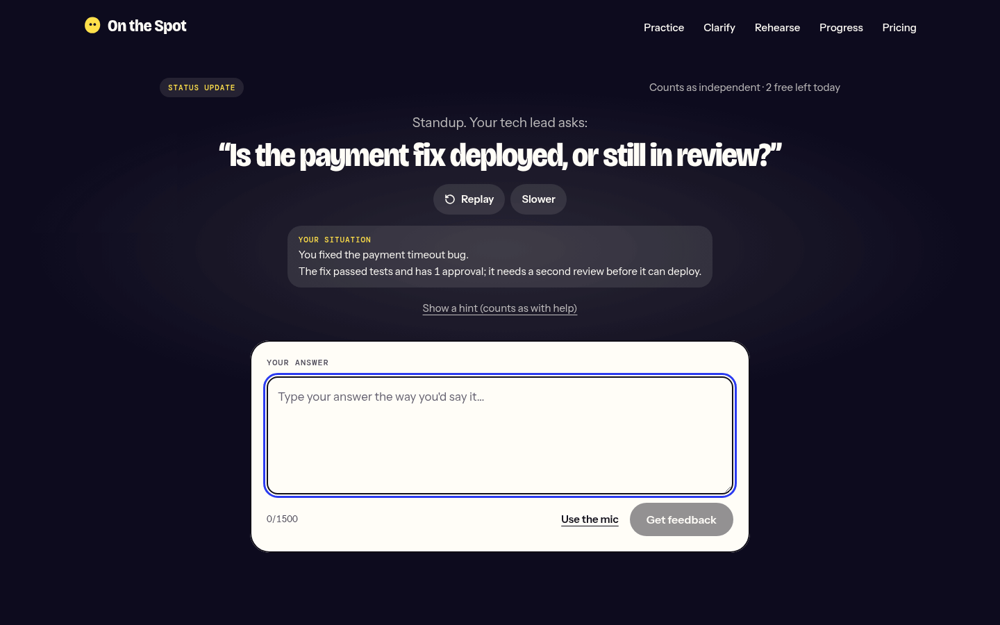
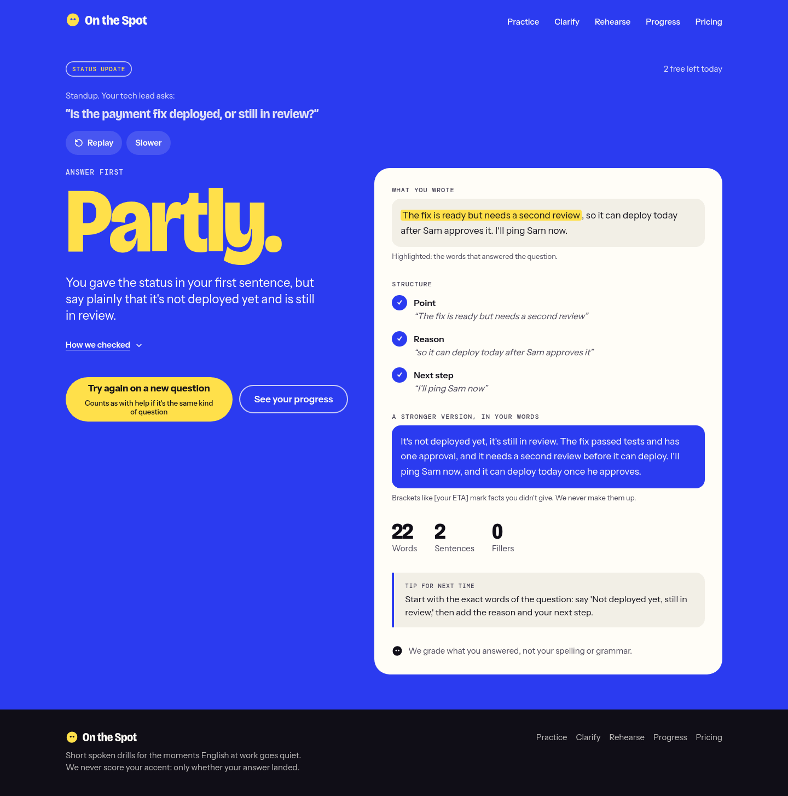
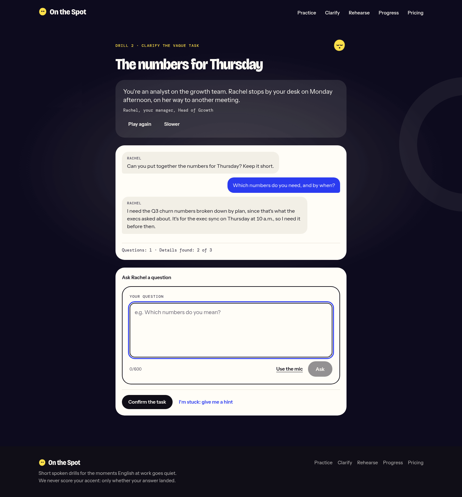
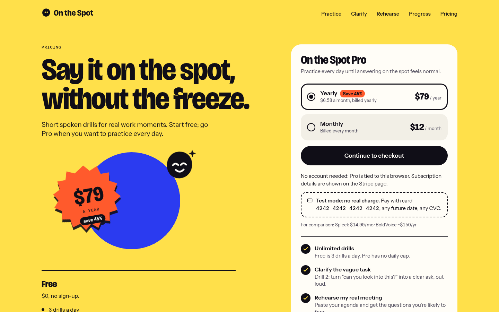
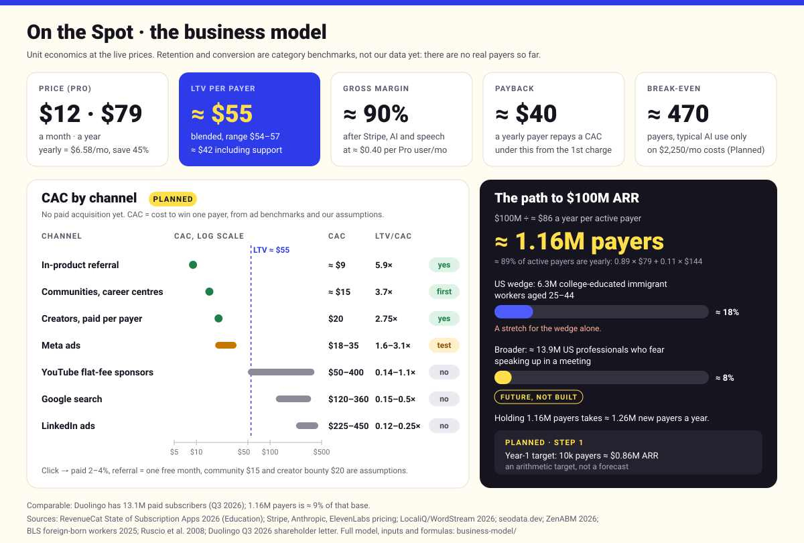

# On the Spot

**A 5-minute daily speaking drill for immigrant professionals who freeze when English is needed on the spot.**

**Live: [https://speak.incode.kz](https://speak.incode.kz)** · No sign-up. Stripe test mode, card `4242 4242 4242 4242`.



## The problem and the user

- **Who:** 14.67M foreign-born workers aged 25–44 in the US, ≈ 6.3M of them college-educated. *(BLS, Labor Force
  Characteristics of Foreign-born Workers 2025, tables 1 and release; the BA+ share is for ages 25+, so 6.3M is an
  order of magnitude.)*
- **The moment:** a surprise question in a meeting. Standup: "Quick one: where are we on the onboarding redesign?"
  English is needed on the spot, and it freezes. *(On the Spot product spec.)*
- **In their words:** "I struggle with 'on the spot', immediate English communication… very important for my career
  since I'm a PM". *(Blind, Microsoft, 2019.)*

## How it works: the jury path (about 2 minutes)

| | |
|---|---|
|  | **1. Pick your role.** "What do you do?" Questions match your job (engineer, PM, designer, analyst…). One tap, no sign-up. |
|  | **2. A cold question, read aloud,** with a 2-line situation so you have facts to answer with. A few seconds to think. |
|  | **3. Answer by voice, or type instead.** Feedback on what you said, never your accent: an answer-first verdict, the structure (point, reason, next step) with your own words quoted, and a stronger version in your words. Then try again. |
|  | **4. Drill 2, "Clarify the vague task".** A manager hands you a vague request; you ask questions until it is clear, then say it back. |
|  | **5. Pro via Stripe Checkout.** $12/month or $79/year, test card `4242 4242 4242 4242`. Pro unlocks unlimited drills, drill 2 and "rehearse my real meeting". |

### What the code decides vs what the AI does

- **Drill 1.** The code runs deterministic checks on the transcript (words, sentences, fillers, whether the first
  sentence answers, whether it is English: `lib/drill1/checks.ts`). Claude writes the feedback against a JSON schema,
  and the server then checks it (`lib/drill1/feedback.ts`):
  every evidence quote must be a real **substring of the transcript** (a structure step without a verified quote is
  shown as not present); the **stronger version** may not add numbers or weekdays you never said (or the question
  didn't give): any new one becomes a placeholder such as `[your number]` or `[the date]`.
- **Drill 2.** The LLM only **extracts evidence spans** (your own words, one per fact) and phrases the manager's
  allowed lines. It never sees the answer key or outputs a verdict. A **deterministic engine** (`lib/drill2/engine.ts`,
  `lib/drill2/normalise.ts`) reads each span and grades every fact: time relation ("by" vs "at"), units, negation,
  self-corrections ("30 minutes, actually 30 hours") and ranges ("2 to 2:30 pm").
- **Speech.** ElevenLabs speech-to-text (Scribe v3) and text-to-speech (Flash v2.5), with a disk cache (fixed
  questions cost nothing after the first play), daily caps on characters and seconds, and a **silent fallback** to the
  browser's Web Speech / `speechSynthesis`. "Type instead" always works.

## Business model

**Same offer as the pitch: $12/month or $79/year, with daily free practice.**

**[Read the full business research and financial model](business-model/RESEARCH.md)** ·
**[Download the business-model PDF](docs/On-the-Spot-Business-Research.pdf)** ·
[Submitted pitch](docs/pitch/On-the-Spot-Esep.pdf)

At 10,000 active payers, the planning model gives about **$72k monthly revenue** and **$3.2k operating profit at
$19.25 cash CAC**, or **$11k at a $10 cash-CAC target**. It includes free users, replacement acquisition, support
and team compensation, before corporate tax and additional growth. These are scenarios, not observed results:
AI $0.40/paid month; five active free users per payer; five Cold drills/free user/month; 5% conversion of new
activated free entrants. Paid demand, usage and acquisition costs remain to be measured.

[Sources](business-model/SOURCES.md) · [How to read the pitch's LTV and margin](business-model/DECK-NOTES.md) ·
[Reproducible calculations](business-model/calculate.py) · [All scenario results](business-model/results.json)

<details>
<summary>Original pitch summary — partial contribution metrics, not company net profit</summary>



The ~$55 LTV and ~90% margin describe narrower cost boundaries. Read the linked full-cost model before using
them to judge profitability.

</details>

## Talking to real people

<table>
  <tr>
    <td width="240"></td>
    <td>
      <blockquote>“What I liked most is that you can practise for the different situations you run into at work… the app shows you right away what you did right and what you need to improve. This is very useful for me.”</blockquote>
      <p>Freelance handyman, US · translated from Kazakh</p>
    </td>
  </tr>
</table>

> “What I especially liked is the chance to practise in advance: pick your field, answer a question and get a concrete
> breakdown: what worked, what was missing and how to make the answer clearer. … At $12 a month, this feels affordable
> to me.”
>
> Lawyer, immigrant professional working in English in the US, after looking through the product · translated from Russian

## Tech and quality

- **Stack:** Next.js 16 (App Router), TypeScript, Tailwind CSS v4, Anthropic Claude (`claude-sonnet-5-5`), ElevenLabs,
  Stripe. **No database:** progress lives in the browser (localStorage); Pro is a signed httpOnly cookie, set only
  after the server verifies the Checkout Session with Stripe.
- **Tests:** 32 test files, **478 tests**, all passing (`pnpm exec vitest run --maxWorkers=1`).
- **How the AI is constrained:** structured JSON output, validated server-side; quotes verified against the
  transcript; a number/day guard on rewrites; drill 2 grading is code, not the model; TTS only speaks texts the server
  vouches for (HMAC tokens); AI calls are rate-limited per guest (60/h), per IP and globally.

### Run locally

```bash
pnpm i
cp .env.example .env.local   # fill in your own keys (Stripe test-mode keys only)
pnpm dev                     # http://localhost:3000
pnpm exec vitest run         # unit tests
```

Required: `ANTHROPIC_API_KEY`, `STRIPE_SECRET_KEY` (test mode; live keys are refused),
`NEXT_PUBLIC_STRIPE_PUBLISHABLE_KEY`. Everything else in [`.env.example`](.env.example) is optional; without
`ELEVENLABS_API_KEY` the app uses browser speech only.

### Deploy

The app ships as a Docker image (Next.js standalone output) run with Docker Compose:

```bash
cp .env.example .env         # fill in values
docker compose up -d --build
```

Put it behind any HTTPS reverse proxy (Pro cookies are `Secure` in production). A named volume keeps the TTS audio
cache and the daily speech budget across redeploys. `GET /api/health` checks Anthropic and Stripe.

### Known limitations

- **Demo billing.** Stripe runs in test mode; no real money moves. The webhook only logs, so renewals, cancellations
  and failed payments don't change access. Pro is a signed cookie per browser (no account), so it doesn't follow you to
  another device; there is no self-serve cancel.
- **Drill 1:** "let you know" can be counted as the filler "you know".
- **Rehearse:** no copy-recap button; the agenda draft isn't saved across reloads; a request isn't cancelled when you
  leave the page.
- **Drill 2:** a lost start response can use up the free Clarify try; some grading edge cases remain (a hedged
  day/time with a narrow quote; "Wednesday 2 to 3 pm, 30 minutes").
- Usage limits are kept in memory and reset on a restart.

## Team

Team Esep: Baltabay Zhanybek, Bekzat Rashiduly.
